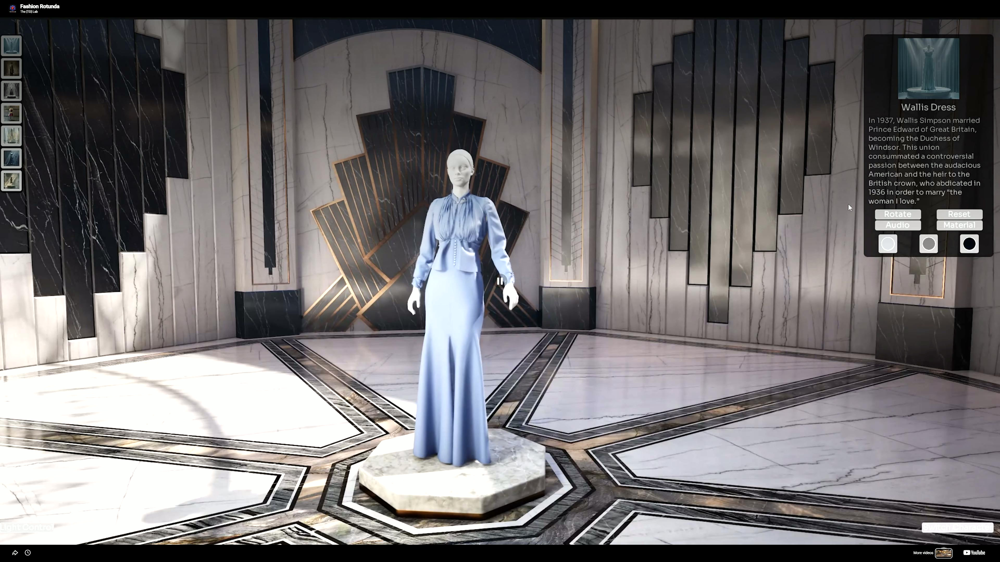
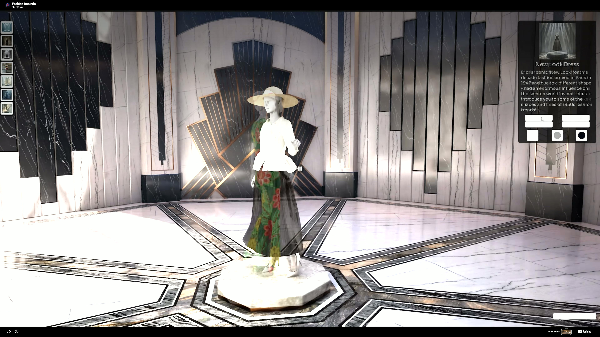
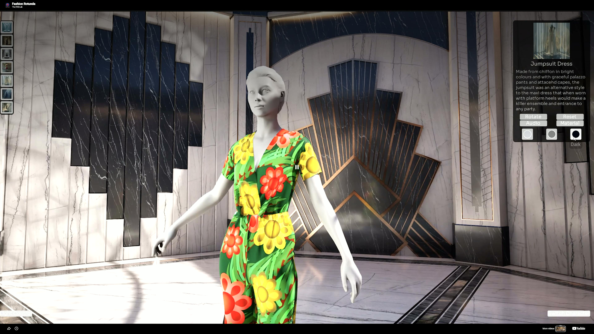
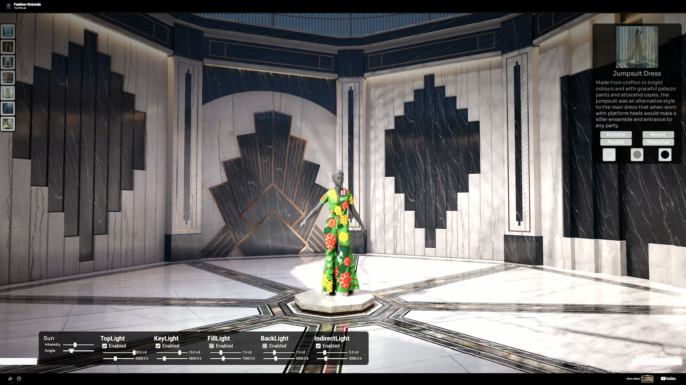
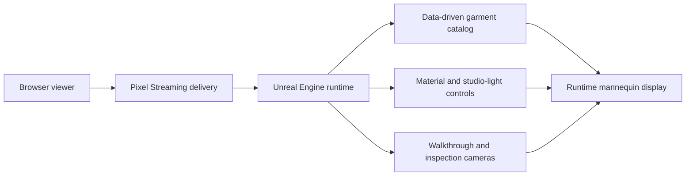

# Fashion Rotunda

<p align="center">
  <strong>An interactive fashion showroom built in Unreal Engine 5.6 for real-time garment presentation, configurable studio lighting, and browser-based delivery.</strong>
</p>

<p align="center">
  <a href="https://youtu.be/V7aMpkPE7ys" title="Watch the Fashion Rotunda video demo">
    
  </a>
</p>

<p align="center">
  <a href="https://youtu.be/V7aMpkPE7ys"><strong>Watch the video demo</strong></a>
</p>

Fashion Rotunda is a high-fidelity virtual showroom that combines architectural visualization with an interactive product presentation workflow. Visitors can explore the rotunda on foot, switch into a dedicated inspection camera, compare mannequin looks and materials, and shape the scene through runtime lighting controls.

The production experience supports Pixel Streaming delivery, allowing the Unreal application to reach a browser without requiring a local game installation. The signaling, hosting, and web-client deployment are maintained outside this public source snapshot.

## Experience highlights

- Data-driven mannequin and garment catalog with thumbnails, descriptions, audio references, and material variants
- Runtime mannequin replacement with reusable display actors and controlled turntable rotation
- Material selection workflow for tagged garment mesh components
- Dual navigation modes: first-person exploration and orbit, zoom, and pan inspection
- Blended camera transitions with preserved transforms between navigation modes
- Runtime studio controls for light visibility, intensity, color temperature, sun intensity, and sun angle
- Animated UMG interface with onboarding, tooltips, product details, and reusable input components
- Desktop-quality rendering configuration using DirectX 12, Shader Model 6, Lumen, ray tracing, and virtual shadow maps
- Pixel Streaming deployment path for browser-accessible presentation

## Visual showcase

<table>
  <tr>
    <td width="33%"><a href="docs/images/fashion-rotunda-new-look-dress.jpg"></a></td>
    <td width="33%"><a href="docs/images/fashion-rotunda-jumpsuit-detail.jpg"></a></td>
    <td width="33%"><a href="docs/images/fashion-rotunda-lighting-controls.jpg"></a></td>
  </tr>
  <tr>
    <td align="center">New Look Dress</td>
    <td align="center">Garment detail</td>
    <td align="center">Runtime lighting</td>
  </tr>
</table>

## Runtime architecture



## Technology

- Unreal Engine 5.6
- C++ with Blueprint-facing data and UI extension points
- Enhanced Input
- UMG and Slate
- Lumen, ray tracing, virtual shadow maps, and Shader Model 6
- Pixel Streaming
- Windows editor and runtime targets

## Repository map

| Path | Responsibility |
| --- | --- |
| `Source/FashionRotunda/Public/` | Blueprint-facing classes and shared data structures |
| `Source/FashionRotunda/Private/Framework/` | Runtime settings, character and inspection-camera control, possession, and transitions |
| `Source/FashionRotunda/Private/MannequinSystem/` | Data-driven mannequin spawning, presentation rotation, materials, and studio-light coordination |
| `Source/FashionRotunda/Private/Lighting/` | Reusable point and rectangular light control surfaces |
| `Source/FashionRotunda/Private/UMG/` | Main interface, tutorial, product information, materials, tooltips, and lighting controls |
| `Config/` | Public-safe project, input, and ownership configuration |
| `scripts/check_repository.py` | Dependency-free repository, descriptor, size, and credential checks |

## Repository scope

This is a source-code and architecture showcase, not a complete production distribution. Proprietary and licensed environment assets, garment content, local editor state, generated build output, deployment infrastructure, and environment-specific configuration are intentionally excluded.

A fresh clone therefore does not reproduce the complete visual experience. Authorized contributors need Unreal Engine 5.6, a compatible Visual Studio toolchain, the private content depot, and the production-safe deployment configuration. Once those dependencies are restored, generate project files and build the `FashionRotundaEditor` target for Win64 Development.

## Repository checks

Run the dependency-free publication checks with:

```bash
python scripts/check_repository.py
```

For a full local source validation, build the editor target with Unreal Engine 5.6:

```powershell
& "C:\Program Files\Epic Games\UE_5.6\Engine\Build\BatchFiles\Build.bat" FashionRotundaEditor Win64 Development ".\FashionRotunda.uproject" -WaitMutex -NoHotReloadFromIDE
```

Pull requests run repository validation, full-history credential scanning, dependency review, and no-build C++ CodeQL analysis. A full Unreal build remains local because GitHub-hosted runners do not include the licensed engine distribution or the private content depot.

## Ownership and licensing

Copyright notices in the project identify Rebel Art Studios. No open-source license is included. Unless a separate written agreement grants permission, the source is provided for viewing and portfolio reference only.
